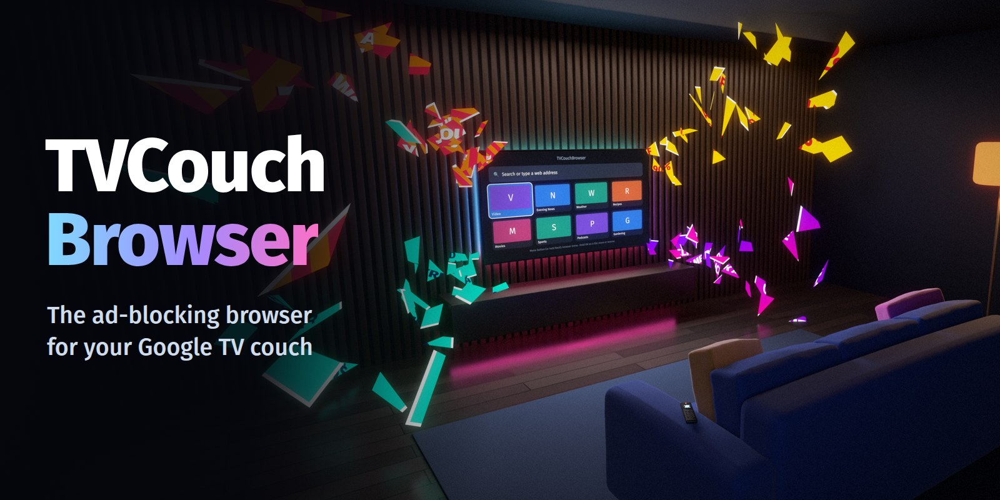
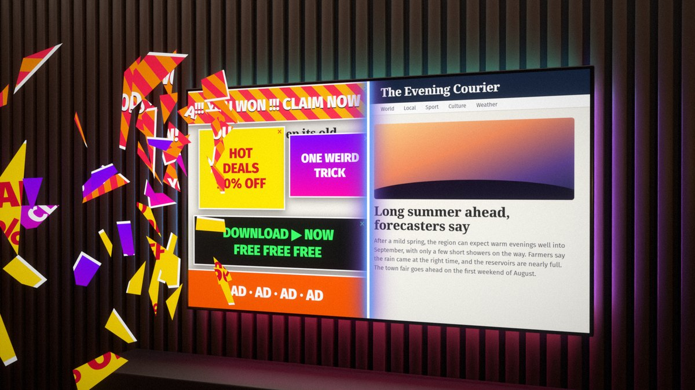
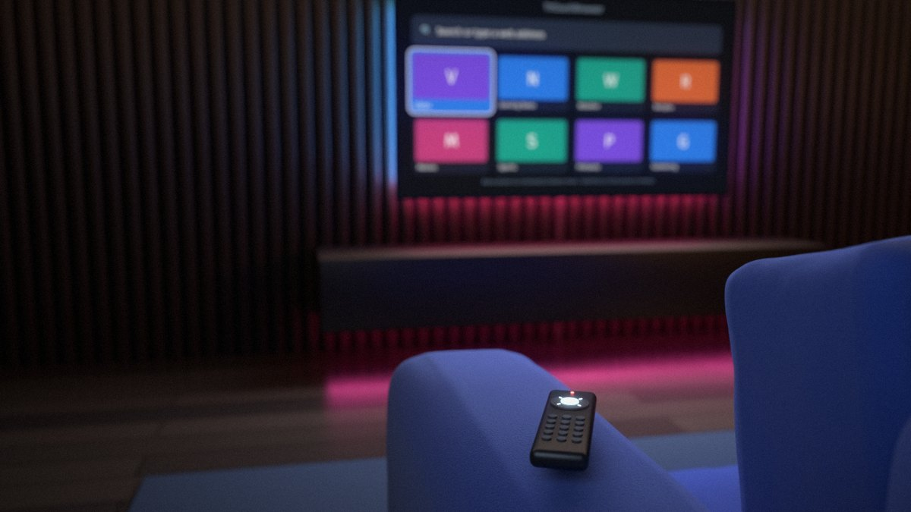
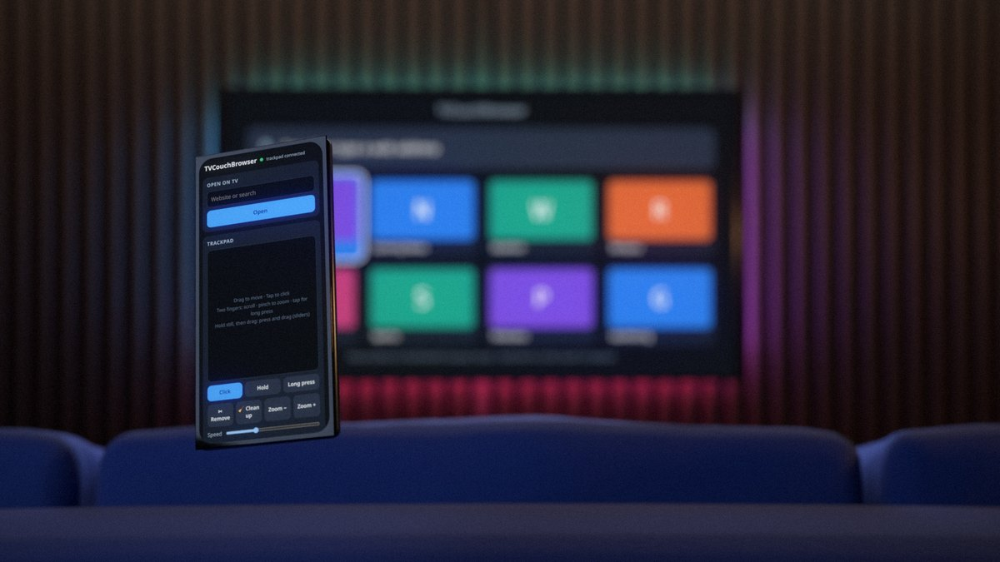
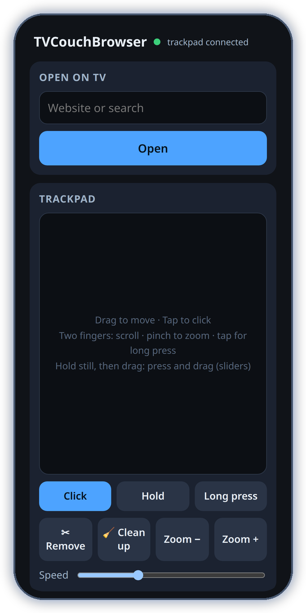

# TVCouchBrowser

A web browser for Android TV that blocks ads, works with a TV remote, and lets you type from your phone.
Built and tested on a TCL 40Q3K (Google TV 14, 32-bit ARM, 1 GB RAM).

<table>
  <tr>
    <td width="33%"></td>
    <td width="33%"></td>
    <td width="33%"></td>
  </tr>
  <tr>
    <td align="center"><b>Blocks ads</b> and clears what the lists miss</td>
    <td align="center"><b>Made for the remote</b> pointer or link-by-link</td>
    <td align="center"><b>Your phone as a trackpad</b> and keyboard, nothing to install</td>
  </tr>
</table>

These are rendered illustrations; the screenshot under [Typing from your phone](#typing-from-your-phone) is the real page. The sites and ads shown are made up.

- **Ad blocking** with EasyList, EasyPrivacy, the uBlock Origin lists, AdGuard Popups and Peter Lowe's list,
  chosen for the most blocking per MB on a 1 GB TV, and updated once a day.
- **Clean up page** and **Remove element** for whatever the lists miss: overlays, cookie walls, sticky ad bars.
- **Your phone as a trackpad** for sites the remote can't handle: point, click, drag, scroll and zoom.
- **Two ways to use the remote**, switched by holding OK: a pointer (cursor mode) or jumping between
  links (link mode).
- **Your phone as a keyboard and remote**: scan a QR code, nothing to install.
- **Send to TV** from the iPhone share sheet: see [docs/send-to-tv-shortcut.md](docs/send-to-tv-shortcut.md).
- Small: a ~160 KB APK, because it uses the Android System WebView already on the TV.

> **Also available in Sofa:** the phone trackpad and remote, Clean up page, Remove element and the extra filter lists
> are in [Sofa TV Browser + TVCouchBrowser features](https://github.com/crash101g/sofa-tv-browser), a fork of
> [Sofa TV Browser](https://github.com/sonalder-darlene/sofa-tv-browser). Sofa adds its own video player with 4K and
> HDR, game pad support, downloads and a home screen. It is about 2 MB and needs Android 7 or newer.
> [Download it from its releases](https://github.com/crash101g/sofa-tv-browser/releases/latest).

## Why WebView and not Firefox's engine

The plan was GeckoView with real uBlock Origin. On the 40Q3K it filled RAM and swap, and the TV's
low-memory killer kept killing its page processes, so pages went blank. The measurements are in
[docs/engine-spike.md](docs/engine-spike.md). So the blocker is built in instead.

**What that means:** this is not uBlock Origin. The blocker understands the common filter-list rules
(blocking by domain and by path, first/third party, exceptions, and element hiding with standard CSS).
It skips regex rules, `$domain=` rules, redirects and uBO's scriptlets. On YouTube, a small script
removes the ad entries from the player data, which is what uBO's scriptlets do; YouTube may change or
detect this.

## Using it with the remote

| Button | What it does |
|---|---|
| D-pad | Cursor mode: moves the pointer (slow at first, faster while held); at the screen edge the page scrolls. Link mode: jumps to the nearest link, button or field in that direction, or scrolls 40% of a screen when there is none. |
| OK | Clicks what is under the pointer, or the link with the ring around it |
| Hold OK | Switches between cursor mode and link mode |
| Back | Leaves full-screen video, then goes back a page, then shows the start screen |
| Menu, or hold Back | Opens the menu: Back, Forward, Reload, Address, Tabs, Bookmarks, Add bookmark, Zoom −/+, Desktop site, Ad blocking, Clean up page, Remove element, Pair phone, Settings |
| Play/Pause, Fast-forward, Rewind | Act on the page's video (FF/Rewind: 10 s) |
| Next, Previous | Jump 60 s forward or back |
| Channel up/down | Page up/down |

On the start screen, hold OK on a bookmark tile to move or remove it. Up to three tabs; when the TV runs
low on memory, background tabs are unloaded and reload when you return to them.

## Blocking what the lists miss

- **Clean up page** (menu, or the phone page) removes full-screen overlays, cookie and newsletter walls,
  and sticky ad bars, and makes a scroll-locked or blurred page usable again. It keeps the site's own
  header and navigation. Menu → Ad blocking → **Clean up this site automatically** runs it on every page load.
- **Remove element**: in the menu, then point at the thing and press OK (or tap **✂ Remove** on the phone
  trackpad). The browser remembers it for that site. Menu → Ad blocking → **Bring back removed elements** undoes it.
- **Pop-ups**: windows opened without a click are blocked. After a click, a window to a filtered ad domain
  (including AdGuard's `$popup` rules) is dropped, a window to the same site opens in a tab, and a window
  to another site asks first. A page that redirects itself to an ad domain without a click is stopped.
- **Dialog loops**: a page gets two alert/confirm boxes; more are dismissed. "Leave this page?" never traps Back.
- **Captchas are never blocked** (reCAPTCHA, hCaptcha, Cloudflare Turnstile, Arkose), so sites behind them
  still open. Solve them with the phone trackpad: its clicks are real touches, which captchas require.
- **Filter lists**: Menu → Ad blocking → **Filter lists…** turns lists on or off. They update once a day,
  also on a TV left on the browser for days; **Update filter lists now** forces it.

### Lists and memory

On by default: EasyList, EasyPrivacy, uBlock filters, uBlock Privacy, Badware risks, Quick fixes, Unbreak,
AdGuard Popups and Peter Lowe's list. Most of their rules block whole servers, which this blocker stores as
9 bytes each, and blocking trackers and ad scripts also leaves the page itself with less to load.

Off by default: the cookie-notice and annoyance lists and AdGuard Mobile Ads. They are mostly element-hiding
rules, which cost far more memory each, and they largely repeat EasyList; **Clean up page** handles most of
what they would. Turn them on in **Filter lists…** if the TV copes.

To keep memory down the blocker also: stores each selector once even when many sites or lists share it,
drops path rules on servers that are blocked outright, and gives the large every-site hiding style sheet
only to the main page, not to each embedded frame.

The browser also no longer tells sites it is an app's WebView (no `; wv` in the user agent, no
`X-Requested-With` header), which some sites and captchas used to refuse or challenge harder.

## Typing from your phone

Menu → **Pair phone** shows a QR code. Scan it with the iPhone camera and a page served by the TV opens:
open a website, type into the field that is selected on the TV, or use the D-pad remote.

### Phone trackpad

The phone page has a trackpad. The pointer appears on the TV as soon as you touch it, in either remote
mode, and also works on the menu, start screen and dialogs.

| On the trackpad | What it does |
|---|---|
| Drag one finger | Moves the pointer (faster flicks go further; set **Speed** below the pad) |
| Tap | Click |
| Hold still, then drag | Press and drag: sliders, slide-to-unlock captchas, maps |
| Hold still, then let go | Long press |
| Two fingers: drag | Scroll what is under the pointer |
| Two fingers: pinch | Zoom |
| Two fingers: tap | Long press |
| **Hold** button | Pressed for as long as your finger stays on it ("press and hold" checks) |
| **✂ Remove** / **🧹 Clean up** | Remove the element under the pointer / clean up the page |

It uses a WebSocket to the TV (`/ws`), with the same token and home-network checks as the rest of the
phone page. It only accepts connections from the phone page itself (the Origin is checked), at most two
at a time, and drops messages past 120 a second.

### Security

- The phone page and its server run **only while the browser is on screen**.
- Every request needs a 128-bit random token, checked in constant time. The token is stored encrypted
  with a key held in the Android Keystore.
- Only devices on the TV's own home network can connect: private (RFC 1918 / ULA) or link-local
  addresses on the TV's subnet. Apps on the TV itself cannot.
- 5 wrong tokens from one address block it for 10 minutes.
- The endpoints take only a URL (`http`/`https` only), text, or a key name; never JavaScript.
- **Settings → Forget paired phones** makes a new token, so old QR codes and Shortcuts stop working.
- **It is plain HTTP on your home network.** Someone who can watch your Wi-Fi traffic could read the
  token and what you type. Don't send passwords through the phone page on a network you don't trust.

## Install

From a GitHub release, with `install-tv-apps.sh`, or by hand:

    adb install -r tvcouchbrowser-<version>-universal.apk

There is one APK for every TV (`universal`): the app has no native code, so it does not need one build
per CPU type.

## Build

JDK 21 and the Android SDK with platform `android-37.2` and build-tools 37.0.0.

    ./gradlew assembleDebug                  # app/build/outputs/apk/debug/app-debug.apk
    tools/release-local.sh                   # signed release + .sha256 in dist/

### Release signing

The release key lives **outside the repo** in `~/.tvcouchbrowser/` (`release.jks` and
`keystore.properties` with its password). **Back up that folder.** If it is lost, a new key can't update
the installed app: everyone would have to uninstall it first and lose their bookmarks.

For GitHub Actions, add these repository secrets, then push a tag such as `v0.1.0`:

| Secret | Value |
|---|---|
| `TVCB_KEYSTORE_BASE64` | `base64 -w0 ~/.tvcouchbrowser/release.jks` |
| `TVCB_KEYSTORE_PASSWORD` | `storePassword` from `keystore.properties` |
| `TVCB_KEY_ALIAS` | `tvcouchbrowser` |
| `TVCB_KEY_PASSWORD` | `keyPassword` from `keystore.properties` |

The workflow publishes a full release (not a pre-release) with `tvcouchbrowser-<version>-universal.apk`
and its `.sha256` (`<hex>  <filename>`).

## Tested on the TCL 40Q3K

Working: start screen, menu, both remote modes, holding OK and Back, bookmarks with thumbnails and
reordering, tabs and unloading under memory pressure, desktop/mobile per site, ad blocking (24–38
requests blocked on the Daily Mail front page), YouTube playback (hardware AV1), full-screen video
and Back out of it, video keys, the screen staying on during playback, QR pairing, typing and Enter from
the phone, token, LAN and rate-limit checks.

Limits found:
- **DRM is Widevine L3 only** in WebView on this TV (`"tee_os":"none"`). Protected test streams play, but
  services that require L1 will refuse or limit quality.
- Some H.264 files (the test-videos.co.uk Big Buck Bunny encodes) fail in the TV's MediaTek decoder
  (`PIPELINE_ERROR_DECODE`); other H.264 and YouTube play fine.
- Filter lists take ~15 s to parse (measured with the original 4 lists) the first time and after each update; after that they load from a cache
  (network blocking ready ~0.7 s after start).

## Artwork

The icon, banner and pictures here are generated by the scripts in [tools/art](tools/art/README.md).

## Licenses

TVCouchBrowser is MIT licensed: see [LICENSE](LICENSE). Third-party parts are listed in [NOTICE](NOTICE). Filter lists are downloaded at run time from their publishers and are not bundled.
